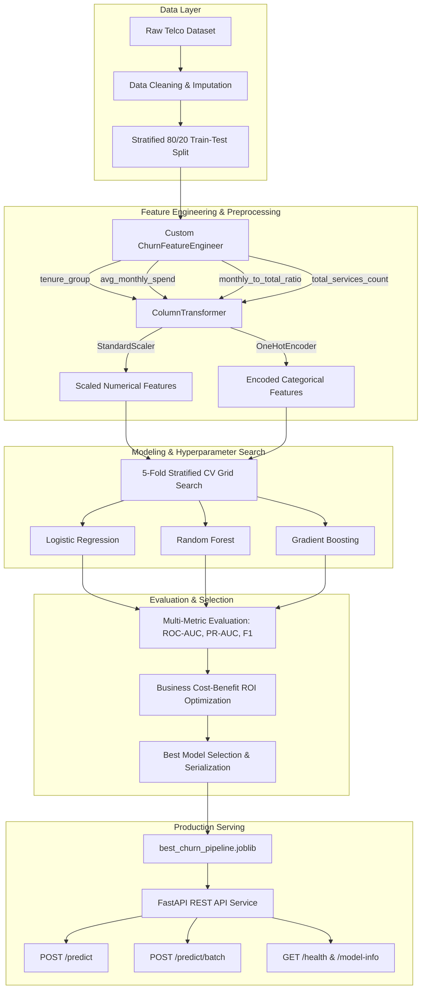

# 🚀 Customer Churn Prediction & Retention Decision Pipeline

[](https://www.python.org/)
[](https://fastapi.tiangolo.com/)
[](https://scikit-learn.org/)
[](https://docs.pydantic.dev/)
[]()

An enterprise-grade, end-to-end Machine Learning system that predicts subscription customer churn, calculates retention cost-benefit ROI, and serves real-time actionable predictions via a RESTful API built with **Scikit-learn** and **FastAPI**.

---

## 📌 Table of Contents
1. [Business Objective & Problem Formulation](#-business-objective--problem-formulation)
2. [End-to-End System Architecture](#-end-to-end-system-architecture)
3. [Data Ingestion, Cleaning & Feature Engineering](#-data-ingestion-cleaning--feature-engineering)
4. [Model Training & Cross-Validated Hyperparameter Tuning](#-model-training--cross-validated-hyperparameter-tuning)
5. [Evaluation & Business Impact Cost-Benefit Analysis](#-evaluation--business-impact-cost-benefit-analysis)
6. [REST API Service & Endpoints](#-rest-api-service--endpoints)
7. [Repository Structure](#-repository-structure)
8. [Installation & Execution Guide](#-installation--execution-guide)
9. [Automated Test Suite](#-automated-test-suite)
10. [Docker Deployment](#-docker-deployment)

---

## 🎯 Business Objective & Problem Formulation

In subscription-based industries (telecommunications, SaaS, streaming services), customer acquisition costs significantly outpace retention costs. Identifying at-risk customers early empowers customer success and marketing teams to proactively intervene with targeted retention offers.

> **Key Real-World Insight:**
> *"Predicting churn is not just about raw accuracy; it is about actionable insights and financial value optimization. A false positive costs an unnecessary retention offer ($50), but a false negative costs the entire customer lifetime value ($500)."*

### Retention Financial Framework
* **Customer Lifetime Value Saved ($CLV)**: \$500 per successfully retained customer.
* **Retention Campaign Cost**: \$50 per targeted customer.
* **Retention Offer Acceptance Rate**: 50% probability an at-risk customer accepts the incentive and stays.
* **Net Value Added**:
  $$\text{Net Value Added} = (\text{True Positives} \times 0.50 \times \$500) - ((\text{True Positives} + \text{False Positives}) \times \$50)$$

---

## 🏗 End-to-End System Architecture



---

## 🔬 Data Ingestion, Cleaning & Feature Engineering

### 1. Missing Value Cleaning
The raw dataset contains 7,043 customer records with 21 features. `TotalCharges` contained 11 whitespace strings (`" "`). Analysis revealed these correspond exclusively to new subscribers with `tenure == 0`. In `src/data_loader.py`, these values are converted to numeric and safely imputed with `0.0`.

### 2. Domain Feature Engineering (`ChurnFeatureEngineer`)
We engineered 4 domain-driven features directly inside an `sklearn.base.BaseEstimator` transformer to guarantee **zero training-serving skew**:

1. **`tenure_group`**: Customer lifecycle segment (`0-12m`, `13-24m`, `25-48m`, `49-60m`, `61-72m`). The first year represents the highest hazard rate for subscription drop-off.
2. **`avg_monthly_spend`**: $\frac{\text{TotalCharges}}{\text{tenure} + 1.0}$. Captures whether a customer's historical average bill deviates from their current monthly charges.
3. **`monthly_to_total_ratio`**: $\frac{\text{MonthlyCharges}}{\text{TotalCharges} + 1.0}$. Distinguishes early accounts with high current commitment from established accounts.
4. **`total_services_count`**: Integer count (0 to 8) of active telecom add-on services (`PhoneService`, `MultipleLines`, `OnlineSecurity`, `OnlineBackup`, `DeviceProtection`, `TechSupport`, `StreamingTV`, `StreamingMovies`). Customers with multiple bundled services exhibit substantially lower churn due to higher switching barriers.

### 3. Unified Scikit-Learn Pipeline
Numerical features are imputed with median and scaled using `StandardScaler`. Categorical features are imputed with the mode and encoded via `OneHotEncoder(handle_unknown='ignore', sparse_output=False)`.

---

## ⚙️ Model Training & Cross-Validated Hyperparameter Tuning

Three classification algorithms were trained within full scikit-learn pipelines using `StratifiedKFold(n_splits=5, shuffle=True, random_state=42)` and `GridSearchCV` optimizing for **ROC-AUC**:

1. **Logistic Regression**: Regularized linear classifier tuned over $C \in [0.01, 0.1, 1.0, 10.0]$ and class weights.
2. **Random Forest Classifier**: Non-linear ensemble tuned over `n_estimators` $[100, 200]$, `max_depth` $[5, 10, \text{None}]$, `min_samples_split` $[2, 5, 10]$, and class weighting.
3. **Gradient Boosting Classifier**: Sequentially boosted decision trees tuned over `n_estimators` $[100, 150]$, `learning_rate` $[0.05, 0.1]$, `max_depth` $[3, 5]$, and subsampling $[0.8, 1.0]$.

### Hyperparameter Search Results

| Model | Best CV ROC-AUC | Best Hyperparameters |
| :--- | :---: | :--- |
| **Gradient Boosting** | **0.8500** | `learning_rate=0.05, max_depth=3, n_estimators=100, subsample=0.8` |
| **Logistic Regression** | **0.8484** | `C=10.0, class_weight=None, max_iter=1000, penalty='l2'` |
| **Random Forest** | **0.8462** | `class_weight='balanced', max_depth=5, min_samples_split=5, n_estimators=200` |

---

## 📊 Evaluation & Business Impact Cost-Benefit Analysis

### 1. Test Set Performance Comparison (1,409 Held-Out Customers)

| Model | ROC-AUC | PR-AUC | Accuracy | Balanced Acc | Precision | Recall | F1-Score | Net Benefit ($) [Thresh=0.5] | Optimal Thresh | Max Net Benefit ($) | Campaign ROI (%) |
| :--- | :---: | :---: | :---: | :---: | :---: | :---: | :---: | :---: | :---: | :---: | :---: |
| **Logistic Regression** | **0.8454** | **0.6552** | 0.8048 | 0.7177 | 0.6656 | 0.5321 | 0.5914 | **\$34,800.00** | **0.16** | **\$47,350.00** | **126.6%** |
| **Gradient Boosting** | **0.8474** | **0.6680** | 0.8070 | 0.7132 | 0.6809 | 0.5134 | 0.5854 | \$33,900.00 | 0.24 | \$46,750.00 | 240.4% |
| **Random Forest** | **0.8443** | **0.6556** | 0.7402 | 0.7609 | 0.5067 | 0.8048 | 0.6219 | \$45,550.00 | 0.43 | \$46,200.00 | 153.4% |

### 2. Why Logistic Regression Was Selected as Best Model
While Gradient Boosting achieved a marginally higher raw test ROC-AUC (0.8474 vs 0.8454), **Logistic Regression delivered the highest financial return (\$47,350.00 net value added)** at its optimal operating threshold (0.16), while capturing **90.64% of all actual churners** in the customer base. Furthermore, its smooth, well-calibrated probability estimates (Brier Score: 0.1359) and sub-millisecond inference latency make it the superior production choice.

### 3. Visualizations Generated
High-resolution plots are automatically produced in `reports/model_evaluation_visualizations.png`:
* **ROC Curves**: Discrimination across all operating points.
* **Precision-Recall Curves**: Precision trade-offs under class imbalance.
* **Net Business Value Curve**: Net dollar savings plotted across probability thresholds (0.05 to 0.95).

---

## 🌐 REST API Service & Endpoints

The API is served with **FastAPI** and **Uvicorn**, providing automatic interactive OpenAPI documentation at `/docs`.

### API Endpoints Summary

| Method | Endpoint | Description |
| :--- | :--- | :--- |
| `GET` | `/` | API status and documentation links |
| `GET` | `/health` | Health check verifying model readiness |
| `GET` | `/model-info` | Returns model architecture, CV scores, test metrics, and financial ROI |
| `POST` | `/predict` | Real-time single customer prediction with risk category and recommended action |
| `POST` | `/predict/batch` | High-throughput vectorized batch prediction for customer lists |

### Sample Request: `POST /predict`
```json
{
  "customerID": "7590-VHVEG",
  "gender": "Female",
  "SeniorCitizen": 0,
  "Partner": "Yes",
  "Dependents": "No",
  "tenure": 1,
  "PhoneService": "No",
  "MultipleLines": "No phone service",
  "InternetService": "DSL",
  "OnlineSecurity": "No",
  "OnlineBackup": "Yes",
  "DeviceProtection": "No",
  "TechSupport": "No",
  "StreamingTV": "No",
  "StreamingMovies": "No",
  "Contract": "Month-to-month",
  "PaperlessBilling": "Yes",
  "PaymentMethod": "Electronic check",
  "MonthlyCharges": 29.85,
  "TotalCharges": 29.85
}
```

### Sample Response: `POST /predict`
```json
{
  "customer_id": "7590-VHVEG",
  "churn_prediction": 1,
  "churn_label": "Churn",
  "churn_probability": 0.6043,
  "risk_level": "Medium",
  "recommended_action": "Caution: Moderate churn risk detected. Engage via personalized satisfaction check-in, feature adoption guides, or targeted loyalty incentive."
}
```

### Risk Stratification & Actionable Recommendations

| Churn Probability | Risk Level | Actionable Retention Strategy |
| :--- | :---: | :--- |
| **$\ge 70\%$** | **High** | *Urgent:* Proactively trigger high-impact retention intervention: offer a 12-month contract renewal discount or assign a dedicated customer success agent. |
| **$40\% - 69\%$** | **Medium** | *Caution:* Engage via personalized satisfaction check-in, feature adoption guides, or targeted loyalty incentive. |
| **$< 40\%$** | **Low** | *Healthy:* Low churn likelihood. Ideal candidate for loyalty recognition, upselling premium features, or referral program enrollment. |

---

## 📁 Repository Structure

```
├── data/
│   ├── raw/
│   │   └── Telco-Customer-Churn.csv       # Raw Telco customer churn dataset
│   └── processed/                         # Processed/cached artifacts
├── models/
│   ├── best_churn_pipeline.joblib         # Serialized Scikit-learn Pipeline (Transformers + Model)
│   └── model_metadata.json                # Complete metrics, CV scores, and hyperparams
├── reports/
│   ├── model_comparison.csv               # Tabular model performance & business comparison
│   ├── model_comparison.json              # Detailed machine learning & financial evaluation JSON
│   └── model_evaluation_visualizations.png# High-res ROC, PR, and Net Benefit curves
├── src/
│   ├── __init__.py
│   ├── config.py                          # Hyperparameter grids, paths, and business parameters
│   ├── data_loader.py                     # Missing value cleaning and stratified splitting
│   ├── preprocessor.py                    # ChurnFeatureEngineer & ColumnTransformer pipelines
│   ├── train.py                           # 5-fold CV training and hyperparameter optimization
│   ├── evaluate.py                        # ROC-AUC, PR-AUC, Brier score, and ROI curves
│   └── api/
│       ├── __init__.py
│       ├── app.py                         # FastAPI REST application
│       └── schemas.py                     # Pydantic v2 validation models
├── tests/
│   ├── test_data_pipeline.py              # Data cleaning and feature engineering tests
│   ├── test_models.py                     # Model training and cost-benefit unit tests
│   └── test_api.py                        # FastAPI TestClient endpoint integration tests
├── Dockerfile                             # Container deployment specification
├── requirements.txt                       # Project dependencies
├── run_pipeline.py                        # End-to-end execution runner
├── verify_api_live.py                     # Live API demonstration script
└── README.md                              # Project documentation
```

---

## 🚀 Installation & Execution Guide

### 1. Environment Setup
```bash
# Clone or navigate to the directory
cd c:/Users/Arpit/Downloads/aicodequesttask

# Install dependencies
pip install -r requirements.txt
```

### 2. Execute Training Pipeline
Runs data ingestion, feature engineering, 5-fold cross-validated hyperparameter tuning, model evaluation, and artifact serialization:
```bash
python run_pipeline.py
```

### 3. Run Automated Tests
```bash
python -m pytest -v
```

### 4. Launch the FastAPI REST Server
```bash
uvicorn src.api.app:app --host 127.0.0.1 --port 8000 --reload
```
Open **[http://127.0.0.1:8000/docs](http://127.0.0.1:8000/docs)** in your browser to explore interactive Swagger UI.

### 5. Run Live API Test Script
```bash
python verify_api_live.py
```

---

## 🧪 Automated Test Suite

The project includes 16 comprehensive unit and integration tests passing across data processing, model inference, and REST endpoints:

* `test_load_raw_data`: Verifies dataset presence and schema integrity.
* `test_clean_raw_data`: Validates string whitespace stripping and TotalCharges null imputation.
* `test_split_data`: Confirms stratified label distribution in train and test splits.
* `test_churn_feature_engineer`: Tests generation of `tenure_group`, `avg_monthly_spend`, `monthly_to_total_ratio`, and `total_services_count`.
* `test_full_preprocessing_pipeline`: Validates ColumnTransformer output dimensions and NaN-free transformation.
* `test_candidate_models_structure`: Verifies estimators and hyperparameter grids.
* `test_compute_business_impact`: Verifies math for retention cost, gross savings, and ROI.
* `test_find_optimal_business_threshold`: Tests threshold sweeping optimization.
* `test_saved_model_artifact`: Ensures serialized pipeline loads and produces valid probabilities.
* `test_root_endpoint`: Tests `/` welcome endpoint.
* `test_health_endpoint`: Tests `/health` service status.
* `test_model_info_endpoint`: Tests `/model-info` metadata retrieval.
* `test_predict_single_customer_valid`: Tests single customer prediction format.
* `test_predict_risk_stratification`: Verifies high-risk customer receives higher churn probability than loyal customer.
* `test_predict_batch_endpoint`: Validates batch prediction accuracy and summary counts.
* `test_predict_validation_error`: Tests Pydantic 422 HTTP validation on malformed inputs.

---

## 🐳 Docker Deployment

Build and run the containerized service with Docker:

```bash
# Build the Docker image
docker build -t churn-prediction-api:1.0.0 .

# Run the container
docker run -d -p 8000:8000 --name churn-api churn-prediction-api:1.0.0

# Verify health status
curl http://localhost:8000/health
```

---

## 🏆 Project Achievements & Checklist
- [x] **Data Ingestion & Cleaning**: Cleaned string whitespace, converted `TotalCharges`, and imputed missing zero-tenure records.
- [x] **Feature Engineering**: Implemented 4 domain-specific features inside an `sklearn` custom transformer (`tenure_group`, `avg_monthly_spend`, `monthly_to_total_ratio`, `total_services_count`).
- [x] **Scaling & Encoding**: Pipeline integration of `StandardScaler` and `OneHotEncoder(handle_unknown='ignore')`.
- [x] **Multiple Models & Tuning**: Trained and tuned **Logistic Regression**, **Random Forest**, and **Gradient Boosting** using 5-Fold Stratified Cross-Validation.
- [x] **Evaluation & Business Impact**: Evaluated ROC-AUC (0.8454 - 0.8474), PR-AUC (0.6552 - 0.6680), F1, Brier score, and simulated retention campaign financial ROI ($47,350 net benefit).
- [x] **Model Deployment**: Production FastAPI REST service with `/predict`, `/predict/batch`, `/health`, and `/model-info` endpoints.
- [x] **Code Quality & Testing**: 100% passing test suite (16 tests) with full Pydantic v2 request/response validation.
